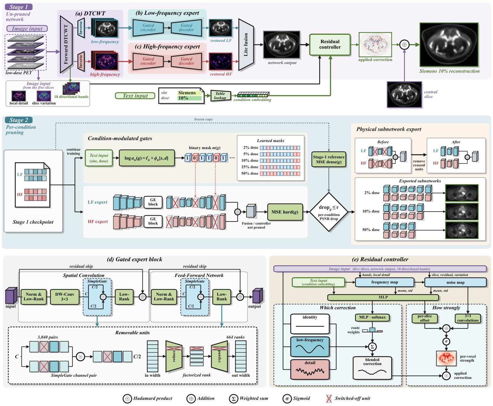

# CAPNet

This repository contains the official PyTorch implementation of the paper: **CAPNet: A Capacity-Adaptive Pruning Network for Resource-Efficient Cross-Scanner Low-Dose PET Imaging**.

<p align="center">
  
</p>

## 1. Environment Setup

First, create the Conda environment using the provided `environment.yml` file and activate it:

```bash
cd CAPNet
conda env create -f environment.yml
conda activate capnet
```

## 2. Data Preparation

To train or test the CAPNet model, you need to prepare your dataset by following these steps:

1. **Format & Normalize**: Normalize your data files (`.nii` or `.dicom`) to the range of `(0, 1.0)` and save them as numpy files.
2. **Naming Convention**: Name the processed files as `(patient_number)_(slice_number)_(data_type).npy`, and put the files of each dose level in a sub-folder named after the dose, such as `2pct`.
3. **Configuration**: Modify the `DATASET_INFO` dictionary in `data/dataset_info.py` to configure your dataset paths, dose levels and test splits. Example:

```python
DATASET_INFO = {
    "siemens": {
        "dir": "DATASET_PATH",
        "input_label": "*_input.npy",
        "target_label": "*_target.npy",
        "test_patients": ['test_id'],
        "val_patients": ["val_id"],
        "doses": ["2pct", "5pct", "10pct", "25pct", "50pct"],
    },
    # Add other datasets here...
}
```

## 3. Training

Run the following command to start training the model from scratch. You can adjust the parameters as needed. Example:

```bash
python train.py \
    --gpu_id 0 \
    --path_to_save checkpoints/exp/ \
    --use_dataset siemens united_imaging ge \
    --batch_size 16 \
    --warmup_epoch 5 \
    --total_epoch 30 \
    --prune_epoch 30 \
    --wave_level 3
```

## 4. Testing

To evaluate the model using a pre-trained checkpoint, run the test script. Example:

```bash
python test.py \
    --gpu_id 0 \
    --ckpt_path checkpoints/exp/model_epoch_X.pkl \
    --use_dataset siemens united_imaging ge \
    --wave_level 3 \
    --output_root results/exp
```
